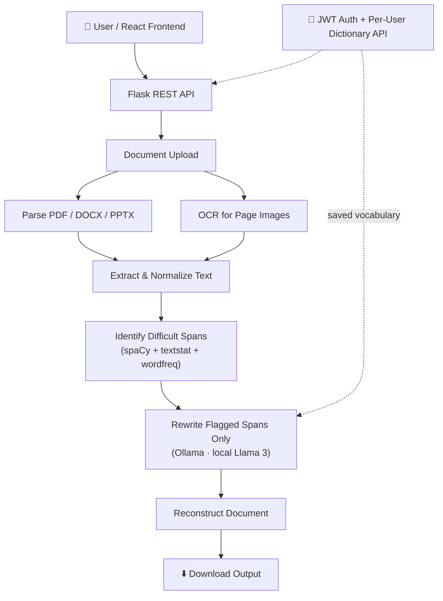

<div align="center">

# 📖 Luminara

### Make academic reading easier without losing the meaning.

An AI-assisted reading app that finds the hard parts of a document, simplifies only those parts, and helps you learn the vocabulary along the way.


**Responsible Computing Club · San José State University · Spring 2026**

</div>

---

## Table of Contents

- [Overview](#overview)
- [Why We Built It](#why-we-built-it)
- [Features](#features)
- [How It Works](#how-it-works)
- [Tech Stack](#tech-stack)
- [Getting Started](#getting-started)
- [Engineering Challenges & Lessons](#engineering-challenges--lessons)
- [Testing & Feedback](#testing--feedback)
- [My Contributions](#my-contributions)
- [Team](#team)

---

## Overview

Luminara helps students work through dense academic material such as textbooks, papers, and lecture slides. It flags difficult language, simplifies selected passages, and builds a personal vocabulary list, while keeping the document's original meaning and structure.

**What makes it different:** Luminara doesn't send a whole document to a generative model. It uses traditional NLP to decide **what** needs attention, then has a **locally running Llama 3** model rewrite only those spans.

| 🎯 Targeted | 🔒 Private | ⚡ Efficient |
|:---:|:---:|:---:|
| Only flagged text is rewritten | Document text stays on a local model | Less generation, fewer wasted resources |

---

## Why We Built It

A lot of academic material is harder to read than it needs to be. Technical vocabulary, long sentences, and dense formatting make studying exhausting, especially for:

- 🌍 students reading in a **second language**
- 🔤 readers who benefit from **dyslexia-friendly** presentation
- 📚 anyone working through an unfamiliar subject

> **Our pivot:** At first, we tried to make complicated text *shorter*. Feedback from our demo changed that goal: **simpler isn't better if important details disappear.** We moved toward helping readers *understand* hard language without rewriting everything around it, and we added a personal dictionary so the app supports learning over time.

---

## Features

| Feature | Description |
|---|---|
| 📄 **Multi-format documents** | Upload PDFs, slide decks (PPTX), Word documents (DOCX), or images of pages. Text is extracted, with OCR where needed, and you can download the processed result as a file. |
| 🎯 **Targeted simplification** | Readability and word-frequency signals flag difficult words and phrases *before* the language model is asked for replacements. |
| 🧠 **Local AI** | Rewriting runs on Llama 3 through Ollama, so no cloud-hosted model processes your document text. |
| 📒 **Personal vocabulary dictionary** | Authenticated endpoints to save, retrieve, and delete words with definitions and parts of speech. Saved words guide later simplifications. |
| ♿ **Accessibility options** | Dyslexia-friendly display and text-to-speech, plus format, language, and page-range options. |
| 🐳 **Containerized setup** | Docker Compose runs the frontend, backend, and local AI service together. |

---

## How It Works

### Core design principle: **flag first, generate second**

NLP identifies the difficult text, and the generative model only writes replacements. This cuts down on unnecessary rewriting and gives us more control over what stays unchanged.

### Architecture



### Document processing pipeline

1. **Validate:** Accept the upload and check its file type.
2. **Extract:** Pull content with a format-specific parser, or with OCR for images.
3. **Analyze:** Score readability and flag difficult spans.
4. **Simplify:** Rewrite only the flagged spans with the local model, using the reader's saved vocabulary.
5. **Reconstruct:** Put the targeted replacements back into the content.
6. **Convert:** Rebuild the output in the source document's file type and structure.
7. **Return & clean up:** Send the downloadable result and delete temporary uploads.

---

## Tech Stack

| Area | Technology |
|---|---|
| **Frontend** | React |
| **Backend & APIs** | Python, Flask, Flask-CORS |
| **NLP & Readability** | spaCy, textstat, wordfreq |
| **Local Language Model** | Ollama, Llama 3 |
| **File Processing** | PyMuPDF, python-docx, python-pptx, pytesseract, Pillow |
| **Authentication** | JWT (PyJWT) |
| **Dev & Orchestration** | Docker, Docker Compose |

---

## Getting Started

### Prerequisites

- [Docker](https://www.docker.com/) and Docker Compose
- [Ollama](https://ollama.com/) with the Llama 3 model, if you run it outside Docker

### Run with Docker Compose

```bash
git clone https://github.com/VishalkiranRaichur/Luminara.git
cd Luminara
docker compose up --build
```

If Ollama runs on your machine instead of in a container, pull the model first:

```bash
ollama pull llama3
```

### Project structure

```
Luminara/
├── backend/            # Flask API, processing pipeline, NLP + LLM integration
├── frontend/           # React app
├── test_files/         # Sample documents for testing
├── docker-compose.yml  # Orchestrates frontend, backend, and Ollama
└── package.json
```

---

## Engineering Challenges & Lessons

**🧩 Preserving meaning**
Early simplification sometimes removed useful details. We narrowed the scope of rewriting and added vocabulary support instead of optimizing only for shorter output.

**📏 Readability scores aren't consistent**
Flesch–Kincaid scores changed with text length, so the app sometimes flagged too much text or too little. Testing on real course textbooks exposed these problems much more clearly than small examples did.

**🏗️ Formatting is harder than plain text**
Extracting words is one problem. Putting them back without breaking headings, titles, and structure is another. The pipeline has to account for the source format at the reconstruction step.

**🔌 Integration matters**
Connecting the React interface, Flask endpoints, dictionary operations, and local inference took a lot of hands-on debugging, mostly around CORS and service ports.

> 💡 **Key takeaway:** AI isn't always more useful when it generates more. In this project, the real challenge was deciding what *not* to change.

---

## Testing & Feedback

- Tested on **textbook material from our own classes** across several subjects, checking readability and whether simplified passages kept their meaning.
- Used **feedback from a live project demo** to change the product's direction.

> ⚠️ **Note:** Luminara was a semester team project. It is not a production-scale or clinically validated accessibility tool, and we make no numerical accuracy or performance claims.

---

## My Contributions

### Vishalkiran Raichur: Lead Backend Developer

I led backend development for Luminara, from the original seven-step processing flow to the Flask services that connect document handling, NLP, and local AI.

- **Document pipeline:** Designed and implemented text extraction and format handling for PDFs, presentations, Word documents, and image-based content.
- **Difficulty detection:** Built the readability-scoring and word-rarity stage so the AI works on flagged sections instead of rewriting the whole document.
- **LLM integration:** Integrated Ollama and Llama 3 to generate replacements for selected text, with support for each reader's saved vocabulary.
- **Authentication & security:** Implemented JWT-based login, rate limiting, disposable-email checks, and password-length validation.
- **Dictionary API:** Built the personal-dictionary API to store, retrieve, and delete words per user.
- **Full-stack integration:** Connected the React frontend to Flask, fixed CORS, port, and API issues, and helped with teammates' code and Figma designs.

---

## Team

Built together through **SJSU's Responsible Computing Club**, Spring 2026.

| Name | Role |
|---|---|
| **Vishalkiran Raichur** | Lead Backend Developer |
| Shivaji Ganesh | Team Member |
| Ryan Deng | Team Member |
| Shubh Rawal | Team Member |
| Naysa Ratra | Team Member |
| Suhas Kappala | Team Member |

---

<div align="center">

*Built by students, for students: to make hard reading a little lighter.* ✨

</div>
